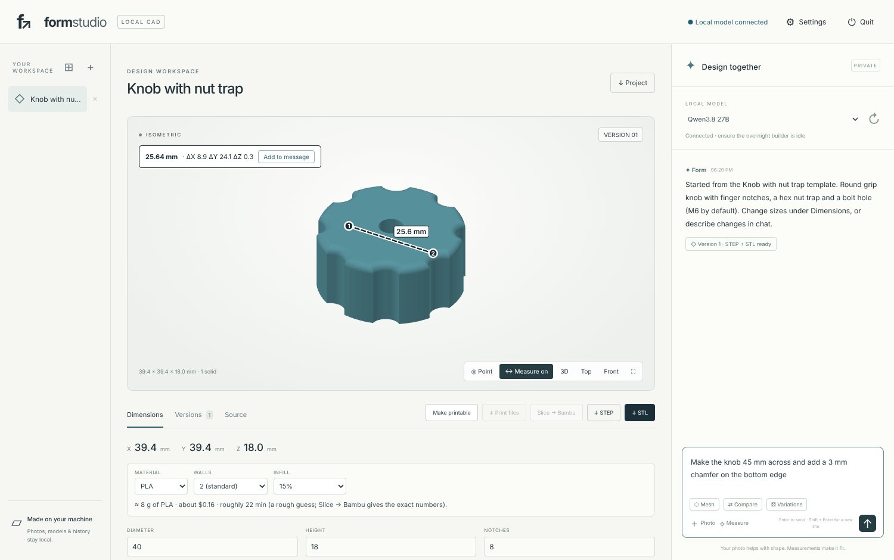
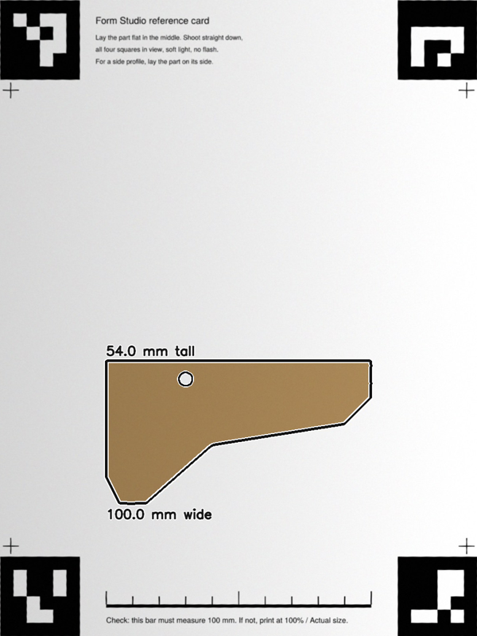
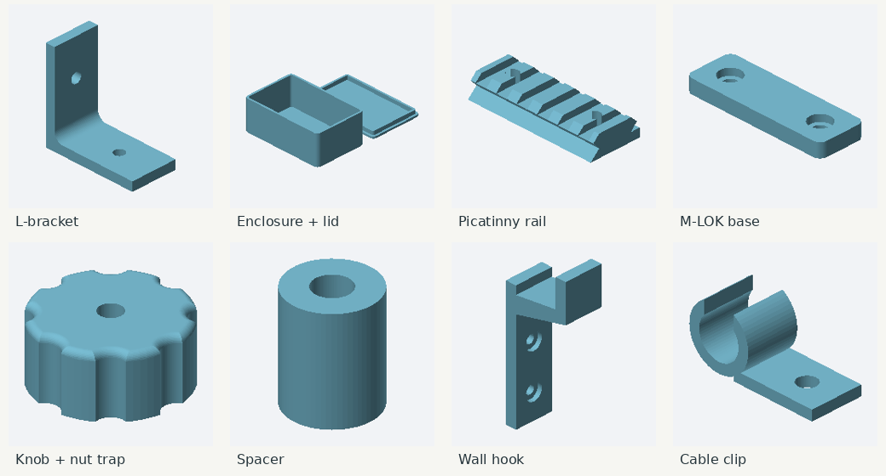

# Form Studio

**Photo-and-chat CAD that runs entirely on your own PC.** Show it a photo, describe the part, and a local vision model (through [LM Studio](https://lmstudio.ai)) writes real, parametric [CadQuery](https://cadquery.readthedocs.io) code. Form Studio builds it, checks it against your photos and sizes, fixes what it can measure as wrong, and gives you STEP + STL files you can slice and print. For sculpted shapes like masks, figures and helmets, it can run [TRELLIS.2](https://github.com/microsoft/TRELLIS.2) through ComfyUI instead.

No cloud, no accounts, no telemetry. Photos, models and history stay in a folder next to the app.



---

## Contents

- [What it does](#what-it-does)
- [How it works](#how-it-works)
- [Requirements](#requirements)
- [Install](#install)
- [Using it](#using-it)
  - [Design in chat](#design-in-chat)
  - [Point at spots and measure on the 3D model](#point-at-spots-and-measure-on-the-3d-model)
  - [Measure a photo: reference card, quarter or credit card](#measure-a-photo-reference-card-quarter-or-credit-card)
  - [Part templates](#part-templates)
  - [Print fit](#print-fit)
  - [Make printable, estimate, slice](#make-printable-estimate-slice)
  - [Mesh mode (TRELLIS.2) and CAD edits on meshes](#mesh-mode-trellis2-and-cad-edits-on-meshes)
  - [Compare and Variations (including overnight)](#compare-and-variations-including-overnight)
  - [Phone access](#phone-access)
- [Security model](#security-model)
- [Files and folders](#files-and-folders)
- [Tests](#tests)
- [Limits and honest caveats](#limits-and-honest-caveats)
- [Troubleshooting](#troubleshooting)
- [Credits](#credits)

---

## What it does

| Feature | What you get |
|---|---|
| **Photo + chat → CAD** | A local vision model writes complete CadQuery programs with named size parameters. Every version keeps its source, STEP, STL and renders. |
| **Self-check** | After each build the model sees renders of what it made plus problems the app *measured*: separate floating pieces, sizes that don't match your stated dimensions, a "fix" that changed nothing. A fix is kept only if it's measurably better. Anything still wrong is reported in chat. |
| **Edit sizes directly** | Every UPPERCASE parameter in the source becomes a field under **Dimensions**. Change a number to rebuild with no AI involved. |
| **Point mode** | Click up to three spots (A, B, C) on the 3D part. Their exact coordinates and surface direction go to the model with your next message: "make the edge at A rounder". |
| **Measure mode** | Click two points on the part to get the distance in mm, plus ΔX/ΔY/ΔZ. |
| **Photo measuring** | Print the reference card, lay the part on it and take a photo from above. Form Studio finds the card, corrects the camera angle and traces the part's outline in real millimetres, holes included. The outline goes to the model as an exact side profile. A quarter or credit card works as a quick fallback: you click its edges. |
| **Part templates** | L-bracket, enclosure + lid, Picatinny rail section, M-LOK accessory base, knob with nut trap, spacer/standoff, wall hook, cable clip. They build instantly without AI and are fully parametric. |
| **Print fit** | A clearance setting for your printer, plus a screw / heat-set insert / nut-trap table built into the model's instructions. |
| **Make printable** | Lays the part on its largest flat side. If it's bigger than your bed, it splits it with dowel-pin holes. |
| **Estimates** | Rough filament weight, cost and time for each version, with material, wall and infill choices (0% infill + 6 walls gives a hollow shell). |
| **Slice → Bambu** | Slices with Bambu Studio's command line and its own X2D presets, then opens the sliced plate in Bambu Studio so you can press Print. You get the exact time and grams. |
| **Mesh mode** | Photo → TRELLIS.2 (ComfyUI) → repaired, real-size mesh. |
| **CAD edits on meshes** | Ask for holes, slots, flat bases or tabs on a sculpted mesh. The model writes CAD cut/add solids and Form Studio applies them as exact mesh booleans. |
| **Polish** | Smooths stair-steps and bumps out of a mesh without changing its size. For TRELLIS.2 meshes it rebuilds from TRELLIS.2's own surface, so detail is kept. |
| **Mesh size fields** | Sculpted and imported models get X / Y / Z size boxes with **Keep proportions**. Type 216 mm and it scales right away, with no AI involved. |
| **Planner** | On meshes, your chat is routed to the right tool: resize, stretch one section, move a part, cut/add material, ask a question, or just answer. "The 912 mm needs to be 216" or "make it 180 mm long" are handled instantly by rules; anything else goes through a short text-only call to the local model. |
| **Import + combine** | Bring in STL / 3MF / OBJ / PLY / GLB files, e.g. from MakerWorld. Start a new design with one, or add it to the current design as a separate part, then say where it goes ("put the spool holder on top, centered") and add slots or holes. |
| **Team review** | Like the overnight runner: your selected model designs it, then a reviewer checks it against your sizes and the measured problems and fixes it. By default the reviewer is the same model with fresh eyes (no slow model swap). Both versions are kept, and the measurably better one stays current. |
| **Progress meter** | While a model works you see what it's doing ("27B is reading your request: 56% · about 40 s left", then "writing: 310 tokens at 21 tokens/s"). Estimates come from that model's past speed on your PC. |
| **Compare** | Runs the same request on each of your models, one after the other, and keeps every result as a version. |
| **Variations** | Several independent attempts, split across your models at different temperatures. Each one is self-checked, the best becomes current, and the run can be scheduled for overnight. |
| **Phone access** | Optional, passcode-protected access from your phone on the home network or Tailscale, with a one-tap **Camera** button. |
| **No console windows** | Opens from a desktop shortcut in its own app window. **Quit** frees its memory. |

## How it works

```
 Browser UI (static/, no build step, no CDN)
        │  loopback HTTP + per-run token
        ▼
 app.py  ── stdlib HTTP server, jobs, projects, versions, scheduler
   │
   ├─► LM Studio  (OpenAI-compatible /v1/chat/completions, thinking off, streamed, cancellable)
   │
   ├─► cad_worker.py        CadQuery in a restricted worker (AST allowlist, 120 s limit) → STEP/STL/metadata
   ├─► preview_render.py    pure-Python renders (isometric / top / front) for the model and the UI
   ├─► printable_worker.py  trimesh + manifold3d: lay flat, split, dowel holes
   ├─► photo_worker.py      OpenCV: ArUco reference card, perspective fix, outline + hole tracing
   ├─► mesh_ops.py          manifold3d booleans: CAD cut/add solids applied to meshes
   ├─► slicer.py            flattens Bambu Studio's X2D system presets → bambu-studio.exe CLI
   └─► mesh_mode.py         starts ComfyUI hidden, converts the TRELLIS.2 editor workflow, runs it, stops it
```

**A design turn** works like this:

1. Build the prompt: system rules + print-fit rules + recent chat + the current CAD source + up to three reference photos + renders of the current version.
2. The model replies with a short message and one ```python block. A reply cut off mid-code is retried, not shown as chat.
3. `cad_worker.py` runs the code. Errors come back to the model with the failing `model.py` line, up to 4 attempts.
4. **Self-check** (up to 3 rounds): renders plus measured defects go back to the model. A fix is kept only if its defect score drops; separate solids weigh more than size mismatches.
5. The version is committed: source, STEP, STL, renders and metadata. Anything still measurably wrong is posted in chat.

**Robustness details learned the hard way:**
- `translate(x, y, z)` is accepted as well as `translate((x, y, z))`.
- A fillet or chamfer that silently returns broken geometry now raises an error, so the model's `try/except` keeps the unrounded part instead of losing the whole version.
- CAD STL exports are welded at 0.01 mm before printing checks, because hairline gaps between curved faces otherwise look like holes.
- Models are told to draw side profiles on `Workplane("XZ")` with `extrude(W/2, both=True)` (a plain XZ extrude goes toward −Y and misses features placed at Y=0), and to *trace* outlines as point lists instead of stacking boxes and circles.

## Requirements

- **Windows 10/11** PC. Developed on an RTX 3090 with 128 GB RAM.
- **LM Studio** with a vision-capable model loaded and its local server running. Qwen3.8 27B with its `mmproj` vision file is the default; any model that can see images works.
- **Python with CadQuery 2.x.** Form Studio itself only needs the standard library, but it runs in your CadQuery environment. The installer adds `numpy trimesh manifold3d mapbox-earcut shapely rtree scipy networkx` and `opencv-python-headless` (installed with `--no-deps` so your numpy isn't touched).
- **Optional:**
  - Bambu Studio, for **Slice → Bambu**. Uses the presets that ship with it; tested with 02.08.
  - ComfyUI portable + [ComfyUI-Trellis2](https://github.com/visualbruno/ComfyUI-Trellis2) + TRELLIS.2 weights, for **Mesh**.
  - The overnight builder (`overnight-ai`). Its `config.json` provides model names, context lengths and load flags. Form Studio checks that the builder is idle before using LM Studio.

## Install

1. Put this folder somewhere permanent, e.g. `%USERPROFILE%\mcp-servers\FormStudio`.
2. Double-click **`Install-Form-Studio.cmd`** once. It finds your CadQuery Python, adds the printing and photo helpers to it, and creates **Form Studio** shortcuts on the Desktop and in the Start menu.
3. Open **Form Studio** from the shortcut. Clicking it again just brings the running app to the front.
4. If the photo tools are missing, Form Studio installs OpenCV in the background on first start; the Measure dialog shows the progress.

For troubleshooting, `Start-Form-Studio.cmd` runs the same app with a console window.

**Settings (⚙):**
- LM Studio address, CadQuery Python, overnight-builder folder, `lms.exe`, Bambu Studio and ComfyUI paths
- Printer build volume (X2D presets included)
- Fit clearance and default material
- Phone access

## Using it

### Design in chat

1. Pick a model under **LOCAL MODEL**. If none is loaded, choose one and click **Load**; it uses your overnight builder's exact settings. Models that can't see photos are labelled.
2. Attach up to three photos with **＋ Photo**, drag-and-drop, or **◉ Camera** on a phone.
3. Describe the part and give the sizes you know ("overall length 100 mm, two 5 mm holes 40 mm apart"), then press Enter.
4. Keep going in the same chat: "move the holes 5 mm inward", "make the base 8 mm thick".
5. **Stop** ends a long request; the previous version stays. **Versions** lets you restore any earlier result.

### Point at spots and measure on the 3D model

- **◎ Point:** click up to three spots on the part. Chips A, B and C appear above the message box. Your next message carries their coordinates and which way each surface faces, e.g. `A at X 32.2, Y -57.4, Z 120.0 mm, on a surface facing +Z (up)`.
- **↔ Measure:** click two points to get the distance. **Add to message** puts it in your next request.

Drag to orbit, shift-drag or right-drag to pan, scroll to zoom. A click without dragging places a point.

### Measure a photo: reference card, quarter or credit card



**Reference card (recommended).** Open **⌖ Measure** → *Print the card* and print it at **100% / Actual size**; the 100 mm bar on the card lets you check. Lay the part flat in the middle (on its side if you want its side profile), keep all four black squares in view, and shoot straight down in soft light.

Form Studio:
1. finds the four ArUco markers (OpenCV, `DICT_4X4_50`, ids 0–3, on a 180 × 240 mm frame) and corrects the perspective
2. separates the part from the white paper
3. traces the outline and any holes in millimetres

You get the width, height, longest and shortest size, hole diameters and positions, and an ordered outline point list. **Add to my message** puts it in your request, and the model builds the profile from those exact points. On synthetic tests with a tilted camera it measures a 100 × 54 mm profile to within 0.2 mm.

**Quarter or credit card (quick).** Click both edges of a US quarter (24.26 mm), the long side of a credit card (85.60 mm), or anything whose size you know. Then click pairs of points on the part and name each measurement. There's no perspective correction, so keep the coin at the same distance from the camera as the part and shoot square-on. Expect a few percent of error.

### Part templates



**⊞** next to **+** in the sidebar opens the template gallery. Each template is a plain CadQuery file in `templates/` with a `# name:` / `# about:` header and UPPERCASE parameters, so adding your own is just dropping in a file.

| Template | Notes |
|---|---|
| L-bracket | Holes in both legs; rounded inside corner gusset. |
| Enclosure box + lid | Press-fit lid with a lip and a `FIT` gap; `PARTS = 2` tells the checker two pieces are intended. |
| Picatinny rail section | MIL-STD-1913 slot spacing (5.23 mm slots on 10.01 mm centers, 3 mm deep). **The 45° clamping profile is approximate: test-fit before relying on it.** |
| M-LOK accessory base | Two counterbored M5 / #10 holes on the 40 mm M-LOK slot pitch (32 mm slots + 8 mm gaps). |
| Knob with nut trap | Finger notches, hex nut trap, bolt hole (M6 by default). |
| Spacer / standoff | Round or hex. |
| Wall hook | Prints on its side for strength. |
| Cable clip | Snap-in clip with a screw tab. |

### Print fit

**Settings → Fit clearance** (default 0.2 mm) is added to every hole or slot that takes a screw, pin, rail or insert. The model also gets a reference table:
- screw clearance holes (M2–M6, #8, #10)
- typical heat-set insert holes (M2 3.2 × 4 … M5 6.4 × 10 mm; check your inserts)
- hex nut traps
- minimum wall thickness

It's asked to keep these values as named parameters, so you can tweak them under **Dimensions**.

### Make printable, estimate, slice

- **Make printable** lays the active version on its largest flat side and centers it. If it doesn't fit your bed, it splits it into pieces with holes for 4 mm × 12 mm dowel pins (0.15 mm clearance). **↓ Print files** downloads the pieces.
- The **estimate** under Dimensions computes weight, cost and time in the browser from the model's real surface area and volume, using your material, wall and infill choices. It's a quick guide.
- **Slice → Bambu** makes the print pieces if needed and slices them with `bambu-studio.exe`. It uses the X2D 0.4 nozzle machine preset, the `0.20mm Standard @BBL X2D` process and the Bambu filament preset for your material, with your wall and infill settings. Then it opens the sliced plate in Bambu Studio, ready to print. The exact time and grams are saved with the version. Bambu's system presets inherit from parents and pull in g-code templates, so `slicer.py` flattens them into complete settings files first. If command-line slicing fails, Form Studio opens the pieces in Bambu Studio instead and tells you why.

The build plate comes from **Settings → Build plate** (Textured PEI by default). Without it, Bambu's command line assumes the Cool Plate, which rejects PETG, ABS and ASA.

Materials: PLA, PLA Matte, PLA Tough, PETG (HF), ABS, ASA, TPU 95A HF, PLA-CF, PETG-CF, PA6-CF.

### Mesh mode (TRELLIS.2) and CAD edits on meshes

Turn on **⬡ Mesh**, attach a photo and say how big ("make it 150 mm tall" or "100 mm long"). Form Studio then:
1. unloads LM Studio to free the GPU
2. starts ComfyUI hidden
3. uploads the photo
4. runs TRELLIS.2 with background removal (rembg downloads its ~170 MB model the first time)
5. stops ComfyUI
6. repairs, rotates and scales the mesh to your size

The result is a normal version you can make printable, slice or download.

Before the first run, Form Studio checks ComfyUI's Python and adds what TRELLIS.2 needs if it's missing:
- `onnxruntime` for background removal. Without it rembg calls `sys.exit` inside ComfyUI's worker, and the job hangs forever with no error.
- `xformers` from PyTorch's own index for your CUDA build, installed with `--no-deps` so torch is never replaced. TRELLIS.2's sparse attention needs flash-attn or xformers. When flash-attn isn't installed, Form Studio switches the model to `sdpa` + `xformers`.

ComfyUI runs unbuffered, and the job status shows its latest progress line (e.g. `Sampling shape SLat: 42%`).

TRELLIS meshes usually have stacked or leaky triangles. If the mesh isn't watertight after hole filling, Form Studio rebuilds it as a closed solid:
1. voxelizes it finely (up to 1000 voxels along the longest side, at most about 60 million in total) and fills the inside
2. contours it with VTK flying edges and smooths it lightly
3. **snaps every new vertex back onto TRELLIS.2's own surface** (the tangent plane of the nearest point, when it's close and faces the same way)
4. decimates to 200k triangles

Only real gaps keep the rebuilt surface, so the result keeps TRELLIS.2's detail with no voxel stair-steps. It always prints and can take CAD cuts.

Before October 28, 2026 the rebuild used a coarse 1/400 grid and no snapping. Thin, long parts came out terraced (the B&T stock was only about 44 voxels thick). Those versions can be fixed with **✨ Polish**. In testing, a single photo of an angled foregrip became a 100 × 29 × 53 mm watertight mesh in about 5 minutes on an RTX 3090.

**No manual workflow export is needed.** `workflows/trellis2_mesh.json` is ComfyUI-Trellis2's *MeshOnly* editor workflow. On each run Form Studio asks the running ComfyUI for its node definitions (`/object_info`) and converts the editor file to API format. It handles seed "control" values, linked widgets, reroutes and newer inputs, and queues only the nodes that feed the export. Overrides in the file's `extra.formstudio` block set the image input, background removal, face count (200k) and file name.

**CAD on a mesh.** Chat with a mesh version active ("drill two 5 mm holes 40 mm apart through the top", "add a flat base"). The model writes CadQuery that defines `cut` and/or `add` solids in the mesh's coordinates, and `mesh_ops.py` applies them with manifold3d. Their parameters show up under Dimensions too: change `HOLE_D` and the cut is reapplied to the same base mesh.

### Resize, stretch and talk to meshes (the planner)

A mesh (from Mesh mode or an import) has no source code, so typing "the dimensions are off" used to dead-end. Now:

- **Dimensions → Size**: type the size you want in X, Y or Z. With **Keep proportions** on, the other two follow as you type; turn it off to change one direction only. Click **Resize ↗**.
- **Just say it.** The planner turns what you write into one operation:

| You say | It does |
|---|---|
| "the 912 mm needs to be 216" | scales everything by 216/912 (rule, instant) |
| "make it 180 mm long" / "120 mm tall" | resizes with proportions locked (rule, instant) |
| "make the butt 10 mm longer" (optionally click the spot with ◎ Point) | stretches only a band around that spot; the ends keep their shape |
| "put the spool holder on top, centered" | moves that part of a combined design |
| "add two 5 mm holes 40 mm apart through the top" | precise CAD cut on the mesh |
| "how long is it?" | answers without changing anything |

### Polish (smooth a mesh)

Under **Dimensions → Surface**, pick a strength and click **✨ Polish**, or just say "it's too steppy, smooth it". The size stays exactly the same and the old version stays in the history.
- **TRELLIS.2 meshes**, including resized or already-polished ones: Form Studio finds TRELLIS.2's original output (`raw.glb` in the version folder) and rebuilds the surface from it with the fine, snapped rebuild above. **Faithful** gives TRELLIS.2's own surface. **Smoother** and **Smoothest** add gentle smoothing on top.
- **Other meshes** (imports, CAD-edited or stretched meshes): windowed-sinc smoothing, which doesn't shrink the part. **Smoothest** also rounds small edges and fine detail.

On the B&T stock from an older run, the rebuild from TRELLIS.2's original sat 0.30 mm (mean) from TRELLIS.2's surface, against 1.38 mm for the old repair.

The planner only asks a question when it truly can't act. Turn it off in Settings if you want every message to go straight to CAD edits.

### Import STL / 3MF and combine

**⇪ Import** (next to Photo) takes STL, 3MF (including Bambu/MakerWorld files with components and per-object model files), OBJ, PLY and GLB, up to 25 MB.
- With a design open, it asks whether to **combine** (the file is added as a separate part beside your design) or **start a new project**.
- Each part keeps its own position; the planner moves them ("move the bracket 20 mm left", "rotate the holder 90 degrees"). Parts that touch are joined into one printable solid.
- After combining, ask for features across the whole thing: "add a slot for a build plate, 260 mm wide and 2 mm tall, through the back". Cuts bake the parts into one piece; resizing does too.

### Team review

Turn on **⚖ Team** and send a request. Form Studio then:
1. builds it with your selected model, with the usual self-check
2. picks the reviewer from **Settings → Team reviewer**:
   - **Same model, fresh eyes** (the default): a new conversation with no swap
   - **The other model**: loads it from the builder's config. Flash-Next is offloaded and writes at about 4 tokens/s.
   - a specific model
3. has the reviewer check the code against your request, your sizes and the measured problems, and fix it if needed. The review is text-only, so it's quick even on an offloaded model.

Both versions are kept. The reviewer's version becomes current unless it measures worse. Team review applies to CAD designs; meshes go through the planner.

### Progress meter

While a local model works, the status box shows the stage and the numbers:
- **Reading** (prompt processing): a bar with a percent and the time left, estimated from that model's past reading speed on your PC. The first run with a model just counts up.
- **Writing**: tokens so far, tokens per second, and a note when it's slower than that model usually is. A thinking model can write for a while before any visible text appears, and the meter says so.

Speeds are kept per model in `data/speed.json` (a moving average).

### Compare and Variations (including overnight)

- **⇄ Compare** runs your request on each model in the builder's config, loading each with its own settings. Every result becomes a labelled version.
- **⚄ Variations** makes 2–8 independent attempts. They're split across your models at different temperatures and each one gets the full self-check. Form Studio scores them by measured defects, makes the best one current, and lists every attempt in chat. Choose **Start → At a time…** to schedule it, e.g. 01:00. Leave Form Studio open and the PC awake. A scheduled run starts only when the overnight builder is idle, stops early if the builder starts, and can be cancelled from the note above the message box.

### Phone access

This is off by default.
1. In Settings, set a passcode (6+ characters) and turn phone access on.
2. Quit and reopen Form Studio.
3. On your phone, open the address shown in Settings. You need the same Wi-Fi or Tailscale.

Windows may ask once to allow Form Studio through the firewall; allow Private networks. On a phone, **◉ Camera** opens the camera directly.

## Security model

- The server binds to **127.0.0.1 only**. It listens on the network only when phone access is on *and* a passcode is set.
- Every write request needs a per-run token. The server also checks Origin, and loopback clients must use a loopback Host name, which blocks DNS-rebinding pages.
- Phone sessions use an HttpOnly, SameSite=Strict cookie stored as a SHA-256 hash, with a PBKDF2 passcode hash. Five wrong tries lock a device out for 10 minutes. **Settings can only be changed on the PC.**
- Strict Content-Security-Policy, `nosniff`, `frame-ancestors 'none'`.
- Generated CAD runs in a separate worker that limits imports to `cadquery` and `math`, checks an AST allowlist of statements and attributes, removes general-purpose builtins, and has a 120 s timeout. **This reduces accidental damage; it is not an OS sandbox for hostile code.** Run Form Studio under a normal, non-administrator account.

## Files and folders

```
app.py                 server, jobs, prompts, self-check, variations, scheduler
cad_worker.py          restricted CadQuery runner (also builds cut/add tools for meshes)
preview_render.py      pure-Python STL renderer
printable_worker.py    lay flat / split / dowels
photo_worker.py        reference card PDF + photo measuring (OpenCV)
photo_tools.py         OpenCV install check + worker calls
slicer.py              Bambu Studio preset flattening + CLI slicing
mesh_mode.py           ComfyUI / TRELLIS.2 runner + editor→API workflow conversion
mesh_worker.py         repair and scale TRELLIS meshes
mesh_ops.py            mesh tools: CAD booleans, scale, stretch, STL/3MF import (stdlib 3MF reader), part assembly
design_tools.py        the planner: rules, prompt, JSON checks, part placement
templates/             part templates (plain CadQuery)
workflows/             TRELLIS.2 workflow
static/                UI: index.html, app.js, viewer.js (WebGL STL viewer + picking), style.css
tests/                 integration tests with a mock LM Studio and a mock ComfyUI
install.ps1, Install-Form-Studio.cmd, Start-Form-Studio.cmd
data/                  (created at run time, git-ignored) projects, settings, logs
```

Each project folder holds the photos, every version's `model.py` (or `tools.py` for mesh edits), `model.step`, `model.stl`, renders, `metadata.json`, execution logs, print pieces, sliced 3MF, and the raw model replies under `turns/`. **↓ Project** downloads a project as a ZIP. Deleted projects move to `data/trash`.

## Tests

```
python -B -m unittest discover -s tests -v
```

The suite runs with a mock LM Studio server, a mock ComfyUI and a fake `bambu-studio` executable, so it needs no GPU or Windows. Real CadQuery, trimesh, manifold3d and OpenCV do the geometry. It covers:
- photo turns, broken-code repair and self-check acceptance rules
- stop during prompt processing, model loading and vision refusal
- worker leniency and error line numbers
- fillets that silently break geometry
- printable/split/dowels, the print ZIP, Compare
- the phone passcode and rate limit
- Mesh mode, editor-workflow conversion, mesh CAD edits and their parameter rebuilds
- the snapped hole repair, Polish (with and without TRELLIS.2's original), resize/stretch/import/combine, the planner and team review
- the progress meter (reading estimate, then remembered speed)
- all templates, reference-card detection on a synthetic tilted photo
- Variations ranking, scheduling and cancel
- Bambu preset flattening and slicing, fit rules, project delete

`VALIDATION.txt` records what was checked on the real PC for each release.

## Limits and honest caveats

- **A photo doesn't give scale or hidden geometry.** Give the sizes that matter, or use the reference card.
- **Local models still make spatial mistakes.** The self-check catches what can be measured: pieces, sizes and unchanged fixes. It doesn't judge style. Expect to steer with a couple of messages, Point mode, or the Dimensions fields. In testing, Qwen3.8 27B turned three photos of an angled foregrip into a single printable solid with the right length, a flat top, the screw holes and a tapering body. It didn't reproduce the real part's hollow skeleton.
- **Flash-Next with photos can be slow:** prompt processing took minutes in testing, which is why 27B is the default.
- **The Picatinny profile is approximate.** Test-fit anything that clamps to a rail.
- **Mesh CAD edits need a watertight mesh.** Mesh mode rebuilds leaky meshes as closed solids, so this rarely blocks; a mesh that still isn't closed is refused with an explanation.
- **Variations and scheduled runs need Form Studio open and the PC awake,** and they yield to the overnight builder.
- **The builder-idle check is read-only, not a lock.** Avoid design sessions that overlap a scheduled builder run.
- Not affiliated with Bambu Lab, Magpul, Microsoft, LM Studio or Qwen.

## Troubleshooting

- **No loaded model:** start LM Studio's server, load a vision model (or use **Load**), then click ↻.
- **No module named cadquery:** set Settings → CadQuery Python to your CadQuery environment's `python.exe`.
- **Measure says the tools are installing:** wait a minute; OpenCV is being added in the background. Details are in `data/opencv-install.log`.
- **Card not found:** all four squares in view, at least two sharp; no glare; print at 100%.
- **Slicing failed:** Form Studio opens the pieces in Bambu Studio instead. The command and Bambu's output are in the version's `print/slice.log`.
- **Mesh mode errors:** check `data/comfyui.log`; dependency installs are logged in `data/comfyui-setup.log`. ComfyUI's own browser page may refuse automated browsers; that doesn't affect Form Studio, which talks to ComfyUI directly.
- **Port 8765 in use:** `python app.py --port 8766`.
- **No interactive 3D (no WebGL):** rendered images are shown instead; use Chrome or Edge.

## Credits

[CadQuery](https://github.com/CadQuery/cadquery) · [trimesh](https://github.com/mikedh/trimesh) · [manifold3d](https://github.com/elalish/manifold) · [OpenCV](https://opencv.org) (ArUco markers) · [LM Studio](https://lmstudio.ai) · [Qwen](https://github.com/QwenLM) · [TRELLIS.2](https://github.com/microsoft/TRELLIS.2) · [ComfyUI](https://github.com/comfyanonymous/ComfyUI) · [ComfyUI-Trellis2](https://github.com/visualbruno/ComfyUI-Trellis2) · [rembg](https://github.com/danielgatis/rembg) · [Bambu Studio](https://github.com/bambulab/BambuStudio)

Started as a ChatGPT-built prototype; debugged, extended and tested on a real RTX 3090 workstation with Claude.
